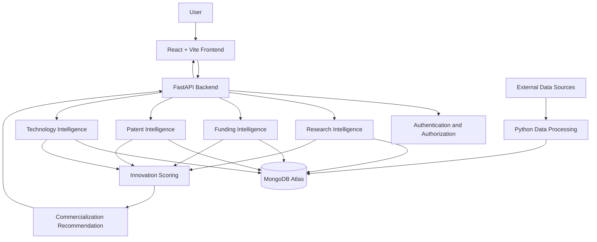

# 🧠 Intelligent Research & Technology Intelligence Platform

### Transforming Research Data into Technology Insights and Commercialization Opportunities

<p align="center">

**Discover · Analyze · Innovate · Commercialize**

</p>

<p align="center">
  
  
  
  
  
</p>

---

## 📌 Overview

**Intelligent Research & Technology Intelligence Platform** is a research intelligence and innovation analysis application designed to help researchers, startup founders, and innovation teams discover relevant research, explore patent landscapes, identify emerging technologies, evaluate innovation opportunities, and investigate potential commercialization pathways.

Research information, patents, funding opportunities, and technology trends are often distributed across different sources. This project aims to bring relevant information into a unified platform and convert it into structured, actionable insights.

The application combines a React-based frontend, a FastAPI backend, MongoDB data storage, and Python-based data processing to support research discovery, technology intelligence, innovation evaluation, and commercialization analysis.

### 🎯 Project Objectives

- Simplify research and technology discovery.
- Analyze patent landscapes and technical innovation.
- Identify emerging technologies and research trends.
- Help researchers discover relevant funding opportunities.
- Evaluate innovation opportunities using structured scoring.
- Explore potential product, licensing, startup, and industry partnership pathways.
- Present research and technology insights through an interactive dashboard.

---

## ✨ Key Features

### 🔬 1. Research Intelligence

- Search and explore research information.
- Retrieve and organize research-paper metadata.
- Support research discovery across relevant topics.
- Explore related research and technology information.
- Provide a foundation for semantic search and research trend analysis.

### 💰 2. Funding Intelligence

- Discover funding opportunities relevant to research areas.
- Compare opportunities with researcher profiles and interests.
- Support funding eligibility and relevance analysis.
- Track funding deadlines and opportunity details where source data is available.

### 📑 3. Patent Intelligence

- Search and analyze patent records.
- Explore patent metadata, technical descriptions, and classifications.
- Investigate technology areas and patenting trends.
- Support patent landscape analysis and competitor research.
- Process large patent datasets for downstream analytics.

### 🚀 4. Technology Intelligence

- Explore emerging technologies.
- Analyze research and patent activity.
- Investigate technology development and maturity.
- Compare technical activity with available adoption indicators.
- Identify possible technology opportunities.

### 📊 5. Innovation Scoring

- Evaluate innovation opportunities using defined scoring criteria.
- Combine relevant technical and market indicators.
- Support comparison and prioritization of opportunities.
- Provide a foundation for explainable innovation assessment.

> The scoring factors, normalization rules, and weights should be documented alongside the implemented scoring logic.

### 💡 6. Commercialization Recommendation

- Explore potential product-development opportunities.
- Investigate technology licensing pathways.
- Identify possible startup opportunities.
- Explore potential industry partnerships.
- Use research, patent, technology, and innovation evidence to support decision-making.

### 👤 7. Authentication and User Experience

- User registration and login.
- Authentication and protected API access where implemented.
- Interactive dashboards and search interfaces.
- Structured presentation of research and technology results.

### 📈 8. Analytics and Reporting

- Present research and technology insights.
- Support analysis of patent and technology trends.
- Provide a foundation for downloadable reports and analytical summaries.

---

## 🏗️ System Architecture

The platform follows a frontend-backend architecture with separate interface, API, data-storage, and processing responsibilities.



### Architecture Components

| Component | Responsibility |
|---|---|
| React + Vite | User interface, navigation, dashboards, and API integration |
| FastAPI | REST endpoints, request validation, backend logic, and response handling |
| MongoDB Atlas | Storage of application records and supported intelligence data |
| Python processing | Data ingestion, transformation, analysis, and other implemented processing tasks |
| External sources | Research, patent, and funding information, depending on available integrations |
| Intelligence modules | Research, funding, patent, and technology analysis |
| Innovation engine | Structured assessment of innovation opportunities |
| Commercialization module | Evaluation of possible routes from technology to market |

*The diagram represents the intended logical architecture. Individual connections and features depend on their implementation in the current codebase.*

---

## 🔄 End-to-End Workflow

The intended workflow connects research discovery with technology analysis and commercialization.

1. **User access:** The user opens the application and authenticates if the selected feature requires authentication.
2. **Research query:** The user enters a research topic, keyword, or technology area.
3. **Data retrieval:** The backend retrieves relevant records from configured data sources and the database.
4. **Research analysis:** The platform organizes research information and identifies relevant technical themes.
5. **Patent analysis:** Relevant patent records are retrieved and analyzed for technical overlap and patenting activity.
6. **Funding analysis:** Available funding opportunities are compared with research interests and eligibility requirements.
7. **Technology intelligence:** Research, patent, and other available indicators are used to investigate technology development and adoption.
8. **Innovation scoring:** Defined factors are evaluated to support structured assessment.
9. **Commercialization analysis:** The system explores potential products, licensing opportunities, startup pathways, and industry partnerships.
10. **Results presentation:** Processed results are returned to the frontend for display and further exploration.

---

## 🛠️ Technology Stack

### Frontend

- **React.js** — component-based user interface
- **Vite** — development server and build tooling
- **JavaScript** — application logic
- **CSS** — styling and responsive presentation

### Backend

- **Python** — backend and data-processing language
- **FastAPI** — REST API framework
- **Pydantic** — request and data validation
- **Uvicorn** — ASGI server for running the backend

### Database and Data Processing

- **MongoDB Atlas** — document database
- **Python data-processing scripts** — importing, transforming, and analyzing datasets
- **External APIs** — configurable sources of research, patent, and funding information

### Development and Testing

- Git and GitHub
- Visual Studio Code
- Postman
- Pytest
- Docker and Docker Compose, where configured

---

## 📁 Project Structure

```text
Intelligent-Research2/
│
├── backend/
│   ├── app/
│   │   ├── main.py
│   │   ├── routes/
│   │   │   ├── auth.py
│   │   │   ├── search.py
│   │   │   ├── funding.py
│   │   │   ├── technology.py
│   │   │   ├── innovation.py
│   │   │   └── commercialization.py
│   │   │
│   │   └── services/
│   │       ├── research_aggregator_service.py
│   │       ├── semantic_search_service.py
│   │       ├── patent_service.py
│   │       ├── technology_service.py
│   │       ├── innovation_service.py
│   │       ├── funding_service.py
│   │       └── commercialization_service.py
│   │
│   ├── tests/
│   ├── requirements.txt
│   └── .env.example
│
├── frontend/
│   └── src/
│       ├── components/
│       ├── pages/
│       ├── services/
│       ├── App.jsx
│       └── index.css
│
├── data/
├── .gitignore
├── docker-compose.yml
└── README.md
```

*This is a representative structure based on the project files discussed. Keep the tree aligned with the actual repository, and add or remove filenames when your implementation changes.*

---

## ⚙️ Getting Started

### Prerequisites

Install the following tools before running the application:

- Python 3.10 or a compatible version supported by the dependencies
- Node.js and npm
- Git
- A MongoDB Atlas database or another configured MongoDB instance

### 1. Clone the repository

```bash
git clone https://github.com/dhikondagopi/Intelligent-Research2.git
cd Intelligent-Research2
```

### 2. Configure the backend

```bash
cd backend
python -m venv venv
```

Activate the virtual environment.

**Windows PowerShell**

```powershell
.\venv\Scripts\Activate.ps1
```

**macOS/Linux**

```bash
source venv/bin/activate
```

Install dependencies:

```bash
pip install -r requirements.txt
```

Create a local `.env` file based on `.env.example`. Configure the variable names required by the current application, for example:

```env
MONGO_URI=your_mongodb_connection_string
JWT_SECRET_KEY=replace_with_a_secure_random_secret
```

If your application integrates external APIs, configure their credentials using the actual environment-variable names expected by your code.

**Security:** Never commit real secrets, database passwords, access tokens, or OAuth client secrets. Use placeholder values in `.env.example`.

### 3. Run the backend

From the `backend` directory, use the appropriate import path for your application.

For the common layout where `app/main.py` creates the FastAPI application:

```bash
uvicorn app.main:app --reload
```

The backend will normally be available at:

```text
http://127.0.0.1:8000
```

Interactive API documentation:

```text
http://127.0.0.1:8000/docs
```

Alternative API documentation:

```text
http://127.0.0.1:8000/redoc
```

### 4. Configure and run the frontend

Open a second terminal:

```bash
cd frontend
npm install
```

Configure the frontend API base URL according to the environment-variable name used in the project. For a Vite application, a typical example is:

```env
VITE_API_BASE_URL=http://127.0.0.1:8000
```

Then start the development server:

```bash
npm run dev
```

Open the local URL printed by Vite, commonly:

```text
http://localhost:5173
```

**Note:** Confirm the environment-variable names, CORS settings, and backend import path against the current source code. The examples above are conventional defaults, not a substitute for the repository's actual configuration.

---

## 🔌 API Documentation

FastAPI can automatically generate interactive documentation for registered endpoints.

| Endpoint | Purpose |
|---|---|
| `/docs` | Interactive Swagger UI |
| `/redoc` | Alternative API documentation |
| `/openapi.json` | OpenAPI schema |

The application's business endpoints depend on the routes registered in `backend/app/main.py` and the corresponding route modules.

To discover the exact endpoints:

1. Start the backend.
2. Open `/docs`.
3. Review the available methods, request parameters, and response schemas.
4. Test endpoints using valid sample data and authentication where required.

---

## 🧪 Testing

The project includes a backend test directory for validating application behavior.

Run the tests from the backend environment:

```bash
pytest
```

For more detailed output:

```bash
pytest -v
```

Recommended test coverage includes:

- Request validation and error handling
- Authentication and authorization
- Research and patent data processing
- Funding and technology endpoints
- Innovation scoring logic
- Commercialization recommendations
- Database and external API failure scenarios

Tests that depend on external services should use mocks or controlled test data where appropriate.

---

## 📊 Data Processing and Patent Analysis

Large-scale patent and research analysis requires reliable ingestion and data validation.

The processing pipeline should support:

- Reading data from supported sources
- Validating and normalizing fields
- Deduplicating records using stable identifiers
- Storing records in the database
- Building suitable indexes for search and filtering
- Running analytics in batches
- Recording errors and processing status

The project has included patent-data ingestion work involving a dataset of approximately 343,000 records. Actual record counts may change as the dataset is updated.

For larger datasets, future improvements can include incremental ingestion, background processing, full-text indexing, vector search, and distributed processing when justified by performance measurements.

---

## 🔐 Security Considerations

Security is important because the application may handle user profiles, research data, external API credentials, and authentication information.

Recommended practices include:

- Keep secrets in environment variables or a managed secret store.
- Exclude `.env` files from Git.
- Use secure password hashing rather than plaintext passwords.
- Validate JWT signatures, expiration, and required claims.
- Enforce authorization on the backend.
- Validate and sanitize user input.
- Configure CORS for trusted frontend origins.
- Use HTTPS in production.
- Avoid returning stack traces or secrets to API clients.
- Apply access controls to private user data.
- Rotate any credentials that have been exposed.

Security features should be documented as implemented only after they have been verified and tested.

---

## 🚀 Future Enhancements

Potential future improvements include:

- Advanced semantic search using embedding models
- Dedicated vector search infrastructure
- Improved patent clustering and technology classification
- Research-gap analysis with traceable supporting evidence
- Explainable innovation scoring
- More reliable funding eligibility matching
- Technology adoption tracking
- Background jobs for large-scale data processing
- Interactive patent landscape visualizations
- PDF and Excel report generation
- Real-time or scheduled alerts
- Expanded automated testing
- Containerized deployment and production monitoring

These enhancements represent possible development directions rather than a claim that every feature is already implemented.

---

## 🎯 Expected Impact

The platform aims to help users:

- Discover relevant research more efficiently.
- Understand technology and patent landscapes.
- Identify promising research directions.
- Explore potentially suitable funding opportunities.
- Compare innovation opportunities systematically.
- Investigate pathways for transferring research into practical applications.

The quality of these insights depends on source-data coverage, update frequency, analytical methods, and validation by domain experts.

---

## 👨‍💻 Project Information

**Project:** Intelligent Research & Technology Intelligence Platform

**GitHub Repository:**  
https://github.com/dhikondagopi/Intelligent-Research2

**Primary Technologies:** React, Vite, FastAPI, Python, MongoDB Atlas

**Core Focus Areas:** Research Intelligence, Funding Intelligence, Patent Intelligence, Technology Intelligence, Innovation Scoring, and Commercialization Recommendation

---

## 📄 License

Choose and add an appropriate open-source license before redistributing this project. Until a license is added, the repository's default copyright restrictions generally apply.

---

<p align="center">

**Built to connect research, technology, innovation, and commercialization.**

</p>
